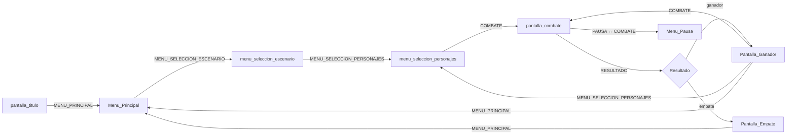

# Núcleo 4 — Sistema de Menús, Flujo de Juego y HUD

Demo aislada y autocontenida del **Núcleo 4** para el juego de pelea 2D colaborativo **GNDU**.
Este núcleo gestiona la capa completa de interfaz visual de usuario (UI/HUD) y el flujo global de pantallas del juego. Se encarga de la navegación desde la pantalla de título hasta los resultados finales, la selección dinámica de personajes y el despliegue del marcador de combate reactivo. Todo esto opera de manera desacoplada mediante señales de GDScript y el `DatosGlobales` Autoload.

---

## Índice

1. [Requisitos y Dependencias](#1-requisitos-y-dependencias)
2. [Estructura del Proyecto](#2-estructura-del-proyecto)
3. [Cómo Ejecutar](#3-cómo-ejecutar)
4. [Arquitectura y Flujo de Estados](#4-arquitectura-y-flujo-de-estados)
5. [Especificación de Eventos (Contratos de Datos)](#5-especificación-de-eventos-contratos-de-datos)
6. [Controles por Pantalla](#6-controles-por-pantalla)
7. [Luchadores y Assets Disponibles](#7-luchadores-y-assets-disponibles)
8. [Casos Especiales y Manejo de Errores](#8-casos-especiales-y-manejo-de-errores)

---

## 1. Requisitos y Dependencias

- **Motor**: Godot Engine 4.x (GDScript)
- **Autoloads requeridos** (configurados en `Project Settings → Autoload`):
  - `DatosGlobales` → `nucleo4_interfaz/scripts/DatosGlobales.gd`
  - `EventBus` → `nucleo4_interfaz/scripts/event_bus.gd`
- **Estructura de assets**: La ruta `assets/Fighters/` debe existir en la raíz del proyecto. Cada subcarpeta representa un luchador. Imágenes esperadas por personaje:
  - `portrait.png` — ícono en la grilla de selección (100×100 px recomendado)
  - `preview.png` — imagen grande en las pantallas de resultado
  - Si alguna imagen falta, el sistema carga automáticamente `assets/Fighters/Default/Default.png` como fallback, sin lanzar excepciones.

---

## 2. Estructura del Proyecto

```
nucleo4_interfaz/
├── scenes/
│   ├── pantalla_titulo.tscn              # Pantalla inicial "Press Start"
│   ├── Menu_Principal.tscn              # Menú principal (Jugar, Opciones, Salir)
│   ├── menu_seleccion_escenario.tscn    # Selector de arena de combate
│   ├── menu_seleccion_personajes.tscn   # Selector de luchadores (P1 y P2)
│   ├── pantalla_combate.tscn            # Orquestador de la pelea
│   ├── HUD.tscn                         # Barras de vida, reloj, combo, gemas
│   ├── Menu_Pausa.tscn                  # Menú emergente de pausa
│   ├── Pantalla_Ganador.tscn            # Resultado: hay ganador
│   ├── Pantalla_Empate.tscn             # Resultado: empate (DRAW)
│   ├── Pantalla_Opciones.tscn           # Ajustes generales
│   ├── Pantalla_InfoControles.tscn      # Info de controles
│   ├── menu_controles.tscn              # Configuración de mandos
│   ├── Escenario_Uni.tscn               # Arena: Unimar
│   ├── Escenario_CampoEntrenamiento.tscn
│   ├── Escenario_Ciudad.tscn
│   ├── Escenario_Desierto.tscn
│   ├── Escenario_Espacio.tscn
│   ├── Escenario_Jungla.tscn
│   └── Escenario_Playa.tscn
└── scripts/
    ├── DatosGlobales.gd                 # Autoload: estado global y señales
    ├── event_bus.gd                     # Autoload: señal de pausa (Núcleo 2 → 4)
    ├── pantalla_titulo.gd
    ├── menu_principal.gd
    ├── menu_seleccion_escenario.gd
    ├── menu_seleccion_personajes.gd
    ├── pantalla_combate.gd
    ├── hud_manager.gd
    ├── simulador_hud.gd                 # Mock de lógica de combate para pruebas aisladas
    ├── menu_pausa.gd
    ├── pantalla_ganador.gd
    ├── pantalla_empate.gd
    ├── escenario_uni.gd
    └── camera_2d.gd
```

---

## 3. Cómo Ejecutar

### Flujo completo (recomendado)
Establece `pantalla_titulo.tscn` como escena principal y presiona **F5**. El juego arrancará desde la pantalla de título y podrás navegar el flujo completo.

### Prueba aislada del HUD
Ejecuta directamente `pantalla_combate.tscn`. El `SimuladorHUD` (`simulador_hud.gd`) actuará como reemplazo del Núcleo 3 y manejará el reloj, vida y rondas usando las teclas descritas en la [Sección 6](#6-controles-por-pantalla).

---

## 4. Arquitectura y Flujo de Estados

### Singleton `DatosGlobales`

El corazón del núcleo. Contiene:

- **`AppState` (enum)**: Representa el estado global de la aplicación.

  | Estado | Descripción |
  |---|---|
  | `MENU_PRINCIPAL` | Menú de inicio |
  | `MENU_SELECCION_ESCENARIO` | Eligiendo arena |
  | `MENU_SELECCION_PERSONAJES` | Eligiendo luchadores |
  | `COMBATE` | Pelea activa (físicas ON) |
  | `RESULTADO` | Pantalla de ganador/empate (físicas OFF) |

- **`cambiar_estado(nuevo_estado, ruta_escena?)`**: Función central que:
  1. Actualiza `estado_actual`
  2. Llama a `aplicar_restriccion_fisicas()` → activa `PhysicsServer2D/3D` **solo** en `COMBATE`
  3. Emite la señal `on_state_change` con el evento completo
  4. Cambia de escena si se proporciona `ruta_escena`

- **Variables persistentes entre escenas**:
  - `p1_fighter_id: String` — ID del luchador del Jugador 1
  - `p2_fighter_id: String` — ID del luchador del Jugador 2
  - `escenario_seleccionado_id: String` — ID del escenario elegido
  - `escenario_seleccionado_nombre: String` — Nombre legible del escenario
  - `ganador_id: String` — `"empate"` o el ID del ganador al finalizar

### Flujo de pantallas y emisión de `on_state_change`



> [!IMPORTANT]
> `PhysicsServer2D` y `PhysicsServer3D` están **desactivados** en todos los estados excepto `COMBATE`. Esto impide que las físicas de los personajes corran mientras se navegan menús, se seleccionan personajes, o se muestra la pantalla de resultado.

### `EventBus`

Nodo autoload secundario que expone la señal:
```gdscript
signal estado_pausa_cambiado(pausado: bool)
```
Usada por el `SimuladorHUD` y el `HUD` para comunicar la pausa entre el Núcleo 2 (Controles) y el Núcleo 4.

---

## 5. Especificación de Eventos (Contratos de Datos)

### A. Eventos que EMITE el Núcleo 4

#### `on_state_change` — Cambio de pantalla

Emitido por `DatosGlobales.on_state_change` cada vez que se llama a `cambiar_estado()`, y también directamente por `menu_pausa.gd` al pausar/reanudar.

```json
{
  "event_name": "on_state_change",
  "source_core": "nucleo4_interfaz",
  "data": {
    "previous_screen": "SELECCION",
    "current_screen": "COMBATE"
  }
}
```

**Tabla de transiciones que emiten este evento:**

| `previous_screen` | `current_screen` | Disparado por |
|---|---|---|
| `MENU_PRINCIPAL` | `MENU_SELECCION_ESCENARIO` | `menu_principal.gd` |
| `MENU_SELECCION_ESCENARIO` | `MENU_SELECCION_PERSONAJES` | `menu_seleccion_escenario.gd` |
| `MENU_SELECCION_PERSONAJES` | `COMBATE` | `menu_seleccion_personajes.gd` |
| `COMBATE` | `RESULTADO` | `pantalla_combate.gd` (fin del combate) |
| `RESULTADO` | `COMBATE` | `pantalla_ganador.gd` (revancha) |
| `RESULTADO` | `MENU_SELECCION_PERSONAJES` | `pantalla_ganador.gd` (cambiar personaje) |
| `RESULTADO` | `MENU_PRINCIPAL` | `pantalla_ganador.gd` / `pantalla_empate.gd` |
| `COMBATE` | `PAUSA` | `menu_pausa.gd` (toggle pausa ON) |
| `PAUSA` | `COMBATE` | `menu_pausa.gd` (toggle pausa OFF / reanudar) |
| `COMBATE` | `MENU_PRINCIPAL` | `menu_pausa.gd` (Salir desde pausa) |

> [!NOTE]
> Las transiciones hacia/desde `PAUSA` se emiten directamente sobre `DatosGlobales.on_state_change` sin pasar por `cambiar_estado()`, ya que la pausa no cambia de escena ni altera el `PhysicsServer`.

---

#### `on_match_start` — Inicio de partida

Emitido desde `menu_seleccion_personajes.gd` cuando ambos jugadores confirman su luchador.

```json
{
  "event_name": "on_match_start",
  "source_core": "nucleo4_interfaz",
  "frame": 0,
  "data": {
    "player_1_fighter_id": "profesor_Mario",
    "player_2_fighter_id": "estudiante_angel",
    "stage_id": "Escenario_Uni",
    "round_time": 99,
    "rounds_to_win": 2
  }
}
```

---

### B. Eventos que ESCUCHA el Núcleo 4

#### `on_combat_event` — Desde el Núcleo 3 (Combate)

Recibido por `hud_manager.gd` a través del método `on_combat_event(datos)`. Acepta tanto `String` JSON como `Dictionary`.

**Tipos de evento soportados (`data.type`):**

| `type` | Descripción | Campos relevantes |
|---|---|---|
| `"HIT"` / `"BLOCK"` | Golpe o bloqueo recibido | `defender`, `attacker`, `current_hp`, `combo_count`, `is_ko` |
| `"TIME_OVER"` | Tiempo agotado | — (el HUD muestra DRAW) |

**Respuesta del HUD por campo:**
- `current_hp` → actualiza la barra de salud verde y anima la barra roja residual (tween 0.6 s)
- `combo_count > 1` → muestra el contador de hits con animación de escala
- `is_ko == true` → muestra el cartel cinemático "K.O."

---

#### `estado_pausa_cambiado(pausado: bool)` — Desde el Núcleo 2 (Controles)

Señal del `EventBus`. El `hud_manager.gd` la escucha para congelar/descongelar el árbol de escena y mostrar/ocultar el `Menu_Pausa`.

---

## 6. Controles por Pantalla

> [!IMPORTANT]
> **El trackpad y el ratón están bloqueados en todas las pantallas de juego.** Toda la navegación se realiza exclusivamente con el teclado.

### Menú Principal (`Menu_Principal.tscn`)

| Tecla | Acción |
|---|---|
| `W` / `A` | Botón anterior |
| `S` / `D` | Botón siguiente |
| `Espacio` | Confirmar / Seleccionar |

### Selección de Escenario (`menu_seleccion_escenario.tscn`)

| Tecla | Acción |
|---|---|
| `W` / `A` | Mover en la grilla (arriba / izquierda) |
| `S` / `D` | Mover en la grilla (abajo / derecha) |
| `Espacio` | Seleccionar (requiere doble pulsación para confirmar) |

> [!TIP]
> La selección de escenario requiere **dos pulsaciones de Espacio**: la primera previsualiza, la segunda confirma. Incluye opción de **Escenario Random**.

### Selección de Personajes (`menu_seleccion_personajes.tscn`)

Los dos jugadores navegan simultáneamente con controles separados:

| Jugador | Movimiento | Confirmar |
|---|---|---|
| **P1** | `W` `A` `S` `D` | `Espacio` (doble) |
| **P2** | `↑` `←` `↓` `→` | `Enter` (doble) |

> [!TIP]
> La confirmación también requiere **dos pulsaciones**: la primera pre-selecciona, la segunda confirma. El combate comienza automáticamente cuando ambos jugadores están listos.

### Pantalla de Combate / SimuladorHUD (`pantalla_combate.tscn`)

Estas teclas son para el **modo de prueba aislada** (sin el Núcleo 3):

| Tecla | Acción |
|---|---|
| `Escape` | Abrir/cerrar menú de pausa |
| `Enter` / `Espacio` | Causar -25 HP a P1 |
| `→` (flecha derecha) | Causar -25 HP a P2 |
| `C` | Simular combo de 5 hits para P1 |
| `V` | Simular combo de 2 hits para P2 |

### Menú de Pausa (`Menu_Pausa.tscn`)

| Tecla | Acción |
|---|---|
| `W` / `A` | Botón anterior |
| `S` / `D` | Botón siguiente |
| `Espacio` | Confirmar opción |
| `Escape` | Reanudar (toggle) |

**Opciones disponibles:**
1. **Reanudar** — cierra la pausa y vuelve al combate
2. **Opciones** — (en desarrollo)
3. **Salir** — regresa al Menú Principal

### Pantallas de Resultado — Ganador y Empate

| Tecla | Acción |
|---|---|
| `W` / `A` | Botón anterior |
| `S` / `D` | Botón siguiente |
| `Espacio` | Confirmar opción |

**Opciones en `Pantalla_Ganador`:**
1. **Revancha** — reinicia la pelea con los mismos personajes (emite `RESULTADO → COMBATE`)
2. **Cambiar Personaje** — vuelve a la selección (emite `RESULTADO → MENU_SELECCION_PERSONAJES`)

**Opciones en `Pantalla_Empate`:**
1. **Salir al Menú** — vuelve al Menú Principal (emite `RESULTADO → MENU_PRINCIPAL`)

---

## 7. Luchadores y Assets Disponibles

Los luchadores se cargan dinámicamente desde `assets/Fighters/`. Los disponibles actualmente son:

### Profesores
| ID de carpeta | Nombre |
|---|---|
| `profesor_Eduardo` | Eduardo |
| `profesor_Flavio` | Flavio |
| `profesor_Franklin` | Franklin |
| `profesor_mara` | Mara |
| `profesor_Mario` | Mario |
| `profesor_Raul` | Raul |
| `profesor_Requena` | Requena |

### Estudiantes
| ID de carpeta | Nombre |
|---|---|
| `estudiante_angel` | Angel |
| `estudiante_gabriel` | Gabriel |
| `estudiante_Gino` | Gino |
| `estudiante_isa` | Isa |
| `estudiante_Miguel` | Miguel |
| `estudiante_Sebas` | Sebas |
| `estudiante_Sergio` | Sergio |

> [!TIP]
> Para **agregar un nuevo luchador** basta con crear una subcarpeta en `assets/Fighters/` con el nombre `profesor_Nombre` o `estudiante_Nombre` y agregar `portrait.png` y `preview.png`. El sistema los detecta automáticamente en tiempo de ejecución sin reiniciar el editor.

### Escenarios disponibles

| ID | Nombre visible |
|---|---|
| `Escenario_CampoEntrenamiento` | Centro de entrenamiento |
| `Escenario_Playa` | Playa |
| `Escenario_Uni` | Unimar |
| `Escenario_Ciudad` | Ciudad |
| `Escenario_Espacio` | Espacio |
| `Escenario_Desierto` | Desierto |
| `Escenario_Jungla` | Jungla |
| `escenario_random` | Escenario Random (aleatorio) |

---

## 8. Casos Especiales y Manejo de Errores

| Situación | Comportamiento |
|---|---|
| `portrait.png` faltante | Se muestra `Default/Default.png`; la grilla no se rompe |
| `preview.png` faltante | Se muestra `Default/Default.png` en la pantalla de resultado |
| Ninguna imagen en `Default/` | Se genera un `GradientTexture2D` oscuro como último recurso |
| Empate por KO simultáneo | La pantalla de resultado muestra `Pantalla_Empate.tscn` |
| Empate por tiempo agotado | Si las vidas son iguales al llegar a 0:00, se declara DRAW |
| Escenario no encontrado | Fallback automático a `Escenario_Uni` |
| Físicas en menús | `PhysicsServer2D/3D` desactivado en todo estado distinto a `COMBATE` |
| Ratón / trackpad | Bloqueado en todas las pantallas de juego (`MOUSE_FILTER_IGNORE`) |
| Apertura de pausa | Detectada por `ui_cancel` (Escape); emite `on_state_change` antes de congelar |

---

## Notas de Integración con Otros Núcleos

| Núcleo | Relación |
|---|---|
| **Núcleo 1 (Personajes)** | Provee las carpetas de assets en `assets/Fighters/` que este núcleo escanea dinámicamente |
| **Núcleo 2 (Controles)** | Envía `estado_pausa_cambiado` vía `EventBus`; en integración completa también enviará los inputs de combate |
| **Núcleo 3 (Combate)** | Recibe `on_match_start`; envía `on_combat_event` con `HIT`, `BLOCK`, `TIME_OVER` que el HUD visualiza |
| **Núcleo 5 (Sonido)** | Escucha `on_state_change` para conmutar pistas de música según la pantalla activa |
